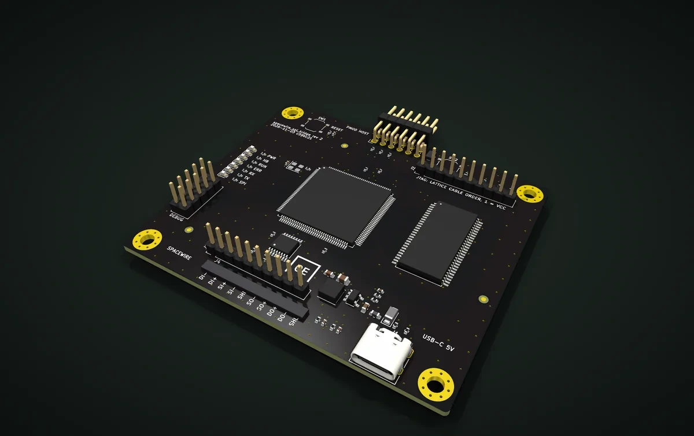
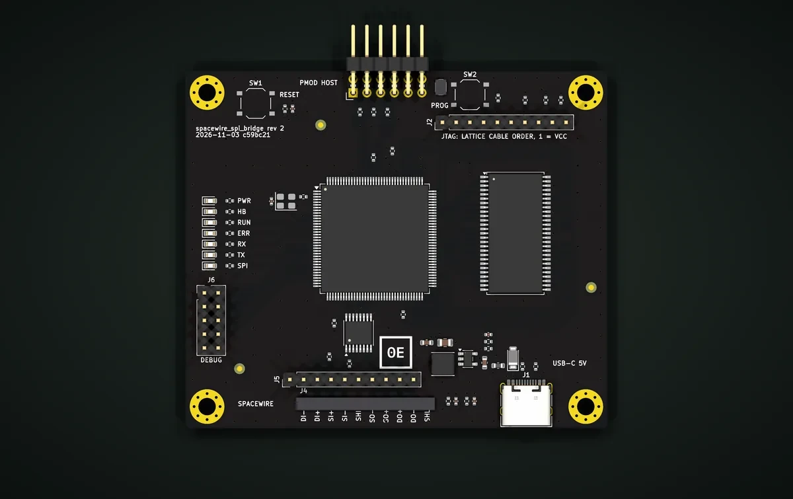
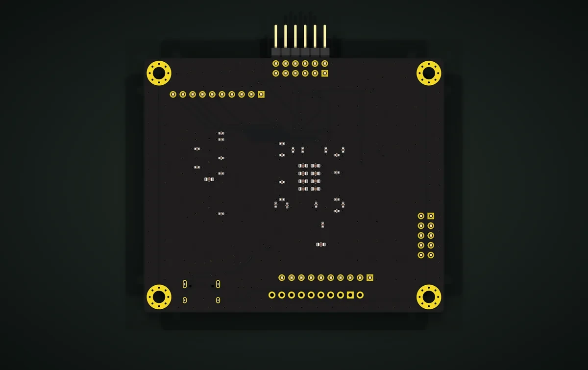
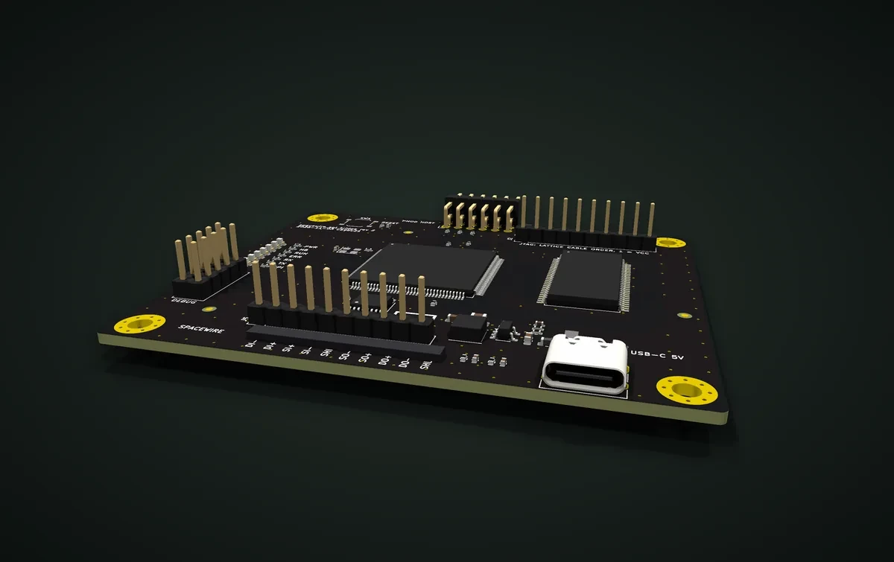

  <a href="https://zeroerrata.eu"><picture>
    <source media="(prefers-color-scheme: dark)" srcset="images/zeroerrata-logo-dark.png">
    
  </picture></a>

<h1 align="center">SpaceWire to SPI bridge with SDRAM FIFO</h1>

<b>A stand-alone adapter between a SpaceWire link and a host MCU on SPI, with 32 MB of SDRAM buffering in a Lattice MachXO2.</b>

  
  
  
  

## About

A stand-alone bridge between one SpaceWire link (ECSS-E-ST-50-12C, 100 Mbit/s, LVDS) and a host microcontroller on SPI (slave, up to 80 MHz, with an interrupt line). A Lattice MachXO2-7000HC FPGA in TQFP-144 runs the SpaceWire codec and two packet FIFOs in a 32 MB SDRAM at 100 MHz, so neither side has to keep up with the other in real time.

Revision 2 places a dedicated 100 nF decoupling capacitor on the bottom side right under every FPGA and SDRAM supply pin. 5 V comes from USB-C, one 3.3 V buck rail feeds the board; the 4-layer board has controlled impedance for the single-ended and LVDS lines.

## Features

- Lattice LCMXO2-7000HC-4TG144C (non-BGA, internal flash, single 3.3 V)
- Alliance AS4C16M16SA 32 MB SDRAM (rev 3; Winbond W9825G6KH before) at 100 MHz CL2 as packet FIFO in each direction
- SpaceWire port with a TI SN65LVDS049 LVDS PHY: micro-D 9S on flying leads or a 1 x 10 lab header
- SPI slave mode 0 up to 80 MHz with IRQ, IRQ2 and RESET on a Pmod Type 2A header
- USB-C 5 V (power only) to a TLV62569 3.3 V / 2 A buck
- Reset and PROG buttons, power and 6 status LEDs, JTAG header for the Lattice cable, debug header

## Specifications

| | |
|---|---|
| Board | 78.0 x 66.0 mm, 4 copper layers, 1.6 mm |
| Finish | ENIG |
| Parts | 102 |
| Release | rev 3, 2026-11-27 |
| SpaceWire | 1 port, 100 Mbit/s, LVDS 100 ohm |
| Host interface | SPI slave, mode 0, up to 80 MHz, IRQ |
| Buffer | 32 MB SDRAM, 16 bit, 100 MHz |
| Supply | USB-C 5 V, about 0.3 A at 3.3 V |
| Stackup | 4 layers, 1.6 mm, controlled impedance (50 ohm single-ended, 100 ohm LVDS) |

## Performance (simulated)

Predictions from the design data, not measurements.

- Controlled impedance from a field solver on the real stackup: single-ended 50.1 ohm, LVDS pair 100.0 ohm.
- Thermal: 0.73 W in total, board maximum 34.1 C at 25 C ambient, still air, horizontal board.

## Renders

| Top | Bottom | Low |
|---|---|---|
|  |  |  |

## Files

| Folder | Contents |
|---|---|
| [`kicad/`](kicad) | KiCad 10 project: schematic, board, design rules, project libraries |
| [`docs/`](docs) | [schematic.pdf](docs/schematic.pdf), [board_layers.pdf](docs/board_layers.pdf) |
| [`fabrication/`](fabrication) | Gerber and drill files (zip), bill of materials, pick-and-place |
| [`images/`](images) | renders and copper layer pictures |
| [`analysis/`](analysis) | simulation and analysis results: bringup, dfm, eye, retpath, thermal |

## Verification

- Impedance of the single-ended (50.1 ohm) and LVDS (100.0 ohm) lines from a field solver
- Thermal map: 0.73 W, board maximum 34 C at 25 C still air: see analysis/thermal
- Every result is a prediction from design data; the board has not been measured unless stated.

## How to order

1. Upload `fabrication/gerbers_drill.zip` to your PCB fab; the stackup and finish are in the specifications above.
2. For assembly, use `fabrication/bom_jlcpcb.csv` and `fabrication/cpl_jlcpcb.csv` (JLCPCB format) or the KiCad-format `bom.csv` / `pos.csv`.
3. Check part stock and the footprints against the current data sheets before you order.

## Known issues

Found by the design review of this release; boards built from these files carry them:

- Rev 3 orders the SpaceWire micro-D by the maker's correct code (Glenair MWDM2L-9S-6E5-18B); rev 1-2 BOMs carry a mixed code that cannot be ordered.
- Reflow balance: from rev 3 the small ground pads connect through thermal reliefs; use a profile with a 60-90 s soak at 150-180 C and inspect the small parts.
- SDRAM (rev 3): the Alliance part needs tRCD / tRP of at least 18 ns (2 cycles at 100 MHz) and its power-up sequence in the FPGA design; the Winbond -6 grade of earlier revisions is not recommended for new designs.

## Notes

- The renders show the ZeroErrata house look; from rev 3 the fabrication package specifies it too: matte black solder mask, white silkscreen, ENIG.
- The FPGA design (SpaceWire codec, FIFOs, SPI slave) is not part of this repository; check the pin map in Lattice Diamond before you order.

## Licence

Released under the [CERN Open Hardware Licence Version 2 - Permissive](LICENSE) (CERN-OHL-P-2.0): use, modify, make and sell it, also commercially. Provided as is, without warranty.

---

  Designed by <a href="https://zeroerrata.eu"><b>ZeroErrata</b></a>: PCB design, verified before it is ordered. 
  <a href="https://zeroerrata.eu">zeroerrata.eu</a> · <a href="mailto:hello@zeroerrata.eu">hello@zeroerrata.eu</a>

